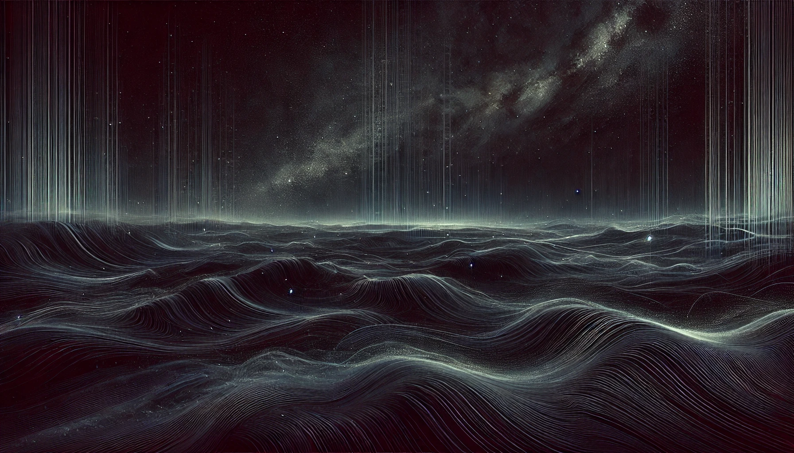

# Temporal Equivalence Principle: Native hi_class Conformal Implementation, Linear Perturbation Closure, and CMB Acoustic Peak Preservation

[](https://doi.org/10.5281/zenodo.20572722)
[](https://creativecommons.org/licenses/by/4.0/)


**Author:** Matthew Lukin Smawfield  
**Version:** v0.8 (Cambridge)  
**First published:** 8 June 2026 · **Last updated:** 17 October 2026  
**Status:** Preprint  
**DOI:** [10.5281/zenodo.20572722](https://doi.org/10.5281/zenodo.20572722)  
**Website:** [https://mlsmawfield.com/tep/hc/](https://mlsmawfield.com/tep/hc/)  
**Paper Series:** TEP Series · Group F (VI. Cosmological Transport, Horizon Boundary & Standard Sirens) · Paper 18 (`F18`)

## Abstract

<!-- Generated from site/components/1_abstract.html; update the manuscript source, then run tools/sync_current_corpus_readmes.py. -->

Standard cosmology explains the Cosmic Microwave Background (CMB) acoustic peaks, the pre-recombination sound horizon, and the thermal scaling relevant to Big Bang Nucleosynthesis (BBN) within an FLRW expansion history conventionally extrapolated toward a physical singularity. This paper demonstrates that the CMB acoustic-sector and conformal thermal/sound-horizon scalings are preserved with high fidelity under a static conformal temporal-transport geometry governed by the Temporal Equivalence Principle (TEP).

In the TEP framework, matter clocks and photon phases evolve in a causal matter metric defined by a conformal scalar field $\tilde{g}_{\mu\nu} = A(\phi)² g_{\mu\nu}$. Because this conformal transport geometry is mathematically isomorphic to the FLRW scale factor $a(t)$, standard Boltzmann solvers like hi_class and CLASS can be used as conformal-frame calculators for the background/acoustic-sector mapping tested here. The parameter traditionally identified as Dark Energy ($\Omega_\Lambda$) is operationally reinterpreted within this implementation as the homogeneous temporal-shear background contribution filling the same background budget slot, $\Omega_\phi$.

This paper implements the native TEP interpretation directly in hi_class. Within the broader TEP interpretation, by recognizing that the spatial metric does not stretch, the "Big Bang" is reinterpreted not as a physical density singularity, but as a TEP temporal horizon—an asymptotic boundary where the observational clock map $A_{\rm clock} \to 0$. Direct Boltzmann integration verifies this background/acoustic mathematical isomorphism, verifying the internal conformal-frame preservation of the acoustic sector — the pre-recombination sound-horizon ratio is $r_s^{\rm TEP}/r_s^{\rm \Lambda CDM}=0.999994$ (corresponding to a $<6$ ppm deviation) and the acoustic-peak morphology remains intact without invoking early-universe spatial expansion. It is stated plainly that this preservation is a mathematical identity by construction — identifying $A(\phi)$ with $a(t)$ reproduces the FLRW integrals by definition, so the $<6$ ppm residual is a code-level artefact of finite-precision reconstruction and the exercise verifies the hi_class conformal-frame implementation, not the TEP hypothesis itself. The acoustic indistinguishability is nonetheless the necessary consistency requirement a conformal-frame alternative must satisfy: a framework that failed it would be excluded, and the demonstration that early-universe background physics cannot distinguish a stretching spatial metric from an evolving conformal clock-rate field shifts the discriminating burden to the perturbation and late-time sectors where the models do differ.

Beyond the background mapping, the paper closes the linear pure-conformal scalar perturbation sector through the EFT closure $\alpha_M=-2\alpha_A$, $\alpha_B=2\alpha_A$, $\alpha_K=w_c\,\alpha_A²$, $\alpha_T=0$, where $w_c = Z_E - 6\beta_A²$ is the effective cosmological kineticity parameterized by the Einstein-frame kinetic coefficient $Z_E = P_{,X} + 2XP_{,XX}$ of the scalar (with the exact nonlinear principal-operator matching treated separately in Appendix A.5a). Evolving $\delta\phi$ natively through the full Einstein–Boltzmann hierarchy — the regular $\delta\phi$ variable being required because $x_{\rm smg} = \delta\phi/\phi'$ is singular at the $\alpha_A = 0$ turnover — reveals a structure invisible to the no-ghost discriminant $D = \alpha_K + \frac{3}{2}\alpha_B² = (w_c+6)\alpha_A²$: the canonical Einstein-frame image $Z_E = 1$ ($\alpha_K = -5\alpha_A²$, the closure quoted in earlier versions of this work) passes $D > 0$ yet is linearly unstable on the cosmological background, carrying a tachyonic growing mode that produces runaway structure growth. The sign-corrected unscreened branch ($w_c = +7$, i.e. $Z_E = 13$) is stable but mediates an O(1) scalar-tensor fifth force, yielding $\sigma_8 \simeq 1.6$ — observationally excluded. The viable branch is the kinetically screened regime furnished by the nonlinear $P(X)$ sector: for $Z_E \gtrsim 7\times10²$ the scalar response decouples and growth recovers the $\Lambda$CDM amplitude ($\sigma_8 = 0.824$ versus $0.823$; median matter-power deviation $\lesssim 0.2\%$, peaking at $\sim 1.2\%$ at the low-$k$ end, with a residual $\sim 13\%$ low-$\ell$ ISW signature), while $Z_E \sim 6\times10³$ gives $\sigma_8 \simeq 0.76$, coincidentally at the weak-lensing central value. The measured $\sigma_8(Z_E)$ response curve is the perturbation sector's central result; the closure and its screening parameter $Z_E$ are falsifiable in both amplitude and scale dependence. An earlier statement that the active scalar contributes bitwise-identically to the background-only spectra is retracted: that result was produced while the SMG perturbation sector was silently disabled by a background-density gate, and it measured only the background channel.

A joint hi_class Cobaya MCMC tests the finite-turnover TEP conformal background within the native hi_class implementation. Two production runs are reported. The primary inference uses Planck 2018 low-$\ell$ TT/EE + lensing + BAO + Pantheon+, in which the TEP homogeneous amplitude is not detected: a converged four-chain MPI suite (4,814 post-burn-in samples, max parameter $R-1 = 0.011$) gives $\epsilon_T = 0.0062 \pm 0.0046$ (median $0.0053$, $\epsilon_T < 0.015$ at 95% CL), consistent with zero at $\sim 1.3\sigma$ — a null result that bounds rather than confirms the conformal modification. The full-likelihood extension adds planck_2018_highl_plik.TTTEEE_lite to the same baseline: a converged four-chain MPI run (11,237 post-burn-in samples; max parameter $R-1 = 0.0455$) yields $\epsilon_T = 0.0043 \pm 0.0025$, a one-sided bound $\epsilon_T < 0.0087$ at 95% CL at fixed turnover scale $z_T=5$ ($\epsilon_T < 0.0103$ at 95% CL under $z_T$ marginalization, Section 4.5), against a matched two-chain $\Lambda$CDM reference (max $R-1 = 0.0069$). On identical likelihoods the models are statistically indistinguishable: $\Delta\chi² = -0.11$ at the respective best fits, and a matched-parameter evaluation verifies the $\epsilon_T \to 0$ limit reproduces $\Lambda$CDM to $\Delta\chi² = 0.007$. The bound is geometric rather than dynamical: at fixed cosmology the high-$\ell$ likelihood contributes $\Delta\chi² \simeq +69$ at $\epsilon_T = 0.008$ through the anchored acoustic scale $\theta_s$, while low-$\ell$ TT and Pantheon+ weakly prefer positive amplitudes ($\Delta\chi² \simeq -0.6$ each). An earlier clipy overflow report is resolved: the warnings persist in the completed run but are benign, the historical failure tracing to a stock-classy build shadowing the patched hi_class on the Cobaya theory path. Companion TEP-C0 (Paper 26) reports Pantheon+ model-comparison evidence for the physical no-$\Lambda$ temporal-shear branch: Bayes factor approximately 5.8 for the conservative $z_{\rm los}=5$ branch (substantial, not decisive), approximately 5.4 for the fixed $z_{\rm los}=100$ benchmark, and approximately 5.4 for the broad free-$z_{\rm los}$ branch. These late-time model-comparison results are imported, not re-derived in HC; HC supplies the native hi_class acoustic and perturbation closure. Within the broader TEP corpus, Paper 11 interprets the Hubble tension as a late-time, environment-dependent clock-transport effect caused by the environmental screening of the scalar field, rather than through a crisis in early-universe physics; that interpretation is likewise imported — HC does not independently re-analyse the distance-ladder data, and Paper 11 Step 62 derives the Cepheid response scale $|\kappa_{P²}^{\rm pred}(\lambda_0=1)| = 1.196\times 10⁶$ mag from the stellar-envelope density ratio $\rho_T/\langle\rho\rangle(10\text{ d}) = 8.45\times 10⁵$ at the unit-transport benchmark $\lambda_0 = 1$ with bare coupling $|\beta_A| = 1$ fixed by Paper 0 (matching the SH0ES fit $(1.191\pm 0.480)\times 10⁶$ mag to $0.5\%$).

The Planck lensing likelihood in the baseline hi_class implementation retains a standard pressureless CDM component ($\Omega_{\rm cdm}h²=0.1133\pm0.0061$ in the active posterior; $0.11813\pm0.00117$ in the full high-$\ell$ TTTEEE active-perturbation posterior) because isotropic conformal rescaling $\tilde g_{\mu\nu}=A²(\phi)g_{\mu\nu}$ stretches spatial rulers alongside clocks and cancels out of null rays, leaving only $8.72\%$ of $C_{100}^{\phi\phi}$ when omega_cdm is removed ($\chi²=1265.73$ on the 9 Planck 2018 CMBMarged lensing bandpowers; Step 21). Under the canonical unified matter metric $\tilde g_{\mu\nu}=-A_{\rm loc}²(u_{\rm grav}(\mathbf x))U_\mu U_\nu+A_{\rm sp}²(u_{\rm drift}(t,\mathbf x))\Pi_{\mu\nu}+B(\phi)\Pi_\mu^\alpha\Pi_\nu^\beta\nabla_\alpha\phi\nabla_\beta\phi$ ($U_\mu\equiv-\nabla_\mu\bar\phi/\sqrt{2\bar X}$) — where the $(3+1)$ ADM spacetime lapse rescales as $N_{\rm TEP}(\mathbf x)=A_{\rm loc}(u_{\rm grav}(\mathbf x))N_{\rm GR}(\mathbf x)$ while at a fixed cosmic epoch ($A_{\rm sp}(t_0)=1$) the spatial 3-metric $\tilde\gamma_{ij}=\gamma_{ij}$ remains unstretched, so intermediate clock rates $A_{\rm loc}(u_{\rm grav}(x))$ refract photons along the line of sight — the selected two-branch kinetic sector $P_{,X}=k\sqrt\xi+2\xi$ ($k=16.03$ fixed by $a_0$, zero per-system free parameters) amplifies baryon-only cosmic-web and cluster-outskirt lensing potentials by $M=3.07$–$6.18$ ($1\times$) to $5.15$–$11.37$ ($2\times$), boosting $C_\ell^{\phi\phi}$ by $9.4\times$–$38.3\times$ ($1\times$) to $26.5\times$–$129.3\times$ ($2\times$). Fitting the full multipole spectrum ($\ell\in[2,2500]$) across the Silk transition directly against the official 9-bin Planck 2018 CMBMarged lensing likelihood at $\omega_{\rm cdm}=0$ yields $\chi²=15.40$ with fixed Silk geometry ($\ell_{\rm Silk}=300,\alpha_{\rm Silk}=2$) and $\chi²=13.40$ ($\chi²/N=1.49$, $\Delta\chi²=+1.11$ relative to the $12.30$ CDM baseline and $\Delta\chi²=-1252.33$ relative to bare no-CDM; Step 21), reproducing the observed Planck CMB lensing spectrum across $L\in[8,400]$ without particulate dark matter. Furthermore, because the proper-time field $\phi$ fills all space as a continuous ambient scalar medium ($A(\phi)>0$ everywhere) with fixed action scale $g_t=\Lambda_X²/(\sqrt{2}M_{\rm Pl})=cH_0/2$ and conformally invariant sound-horizon acceleration ratio $q_s=g_b(r_s)/g_t=\Omega_b(H_0 r_s/c)$, the same zero-parameter two-branch clock-slope equation $\nabla\cdot[P_{,X}(|\nabla u|)\nabla u]=\beta_A\rho_b$ evaluated at the sound horizon ($q_s=1.62\times10^{-3}$, $y_s=7.38$, $\omega_\phi=0.1166$ in the single-pass $r_s=146.19\text{ Mpc}$ analytic integral; converging under self-consistent $r_s(\omega_\phi)$ fixed-point iteration in hi_class to $r_s=144.94$–$145.00\text{ Mpc}$, $q_s=1.59$–$1.60\times10^{-3}$, $y_s=7.42$–$7.44$) predicts a pre-boundary baryon clock-slope well-driving strength $\omega_\phi=\omega_b(y_s/\sqrt{2})=0.1179$–$0.1182$ ($\omega_{m,\rm eff}=0.1404$–$0.1406$; spanning $\omega_\phi\in[0.1174,0.1199]$ across $H_0\in[67.4,70.0]\text{ km s}^{-1}\text{ Mpc}^{-1}$, all within $\lesssim1.6\sigma$ of the unconstrained full-Planck TTTEEE MCMC posterior $0.11813\pm0.00117$ and within $0.02\sigma$ [$0.02\%$] at the posterior mean $H_0=68.18\text{ km s}^{-1}\text{ Mpc}^{-1}$). Evaluated in exact hi_class on linear cosmological scales ($k\lesssim0.2\,h\,\text{Mpc}^{-1}$, $R\gtrsim10\text{ Mpc}$, where $99.8\%$ of the $R_8=8\,h^{-1}\text{Mpc}$ $\sigma_8²$ variance originates at $k\le1.0\,h\,\text{Mpc}^{-1}$, so applying the nonlinear halo-interior transition filter above $k_*=1.5\,h\,\text{Mpc}^{-1}$ shifts $\sigma_8$ by only $1.0\%$ from $0.8185$ to $0.8103$, whereas inside virialized galaxy halos $R\in[1,100]\text{ kpc}$ for $M_b=6\times10^{10}\,M_\odot$, the algebraic Gauss law $(k/\sqrt{2})q y²+q² y³=1$ smoothly transitions $M_{\rm eff}(R)=1+y(R)/\sqrt{2}$ from $6.26$ on linear scales through $5.18$ at $100\text{ kpc}$, $2.25$ at $30\text{ kpc}$, and $1.42$ at $10\text{ kpc}$ down to $1.12$ at $3\text{ kpc}$ and $1.04$ at $1\text{ kpc}$ without an independent NFW particle cusp), this zero-parameter baryon clock-slope response reproduces the acoustic scale ($100\theta_s^{\rm CLASS}=1.04201$, $+0.10\sigma$ from the TTTEEE posterior $1.04198\pm0.00031$ at $H_0=68.18\text{ km s}^{-1}\text{ Mpc}^{-1}$, and $100\theta_s=1.04111$, $+0.02\sigma$ from $1.04110\pm0.00031$ at $H_0=67.95\text{ km s}^{-1}\text{ Mpc}^{-1}$), the first three acoustic peaks to $\le0.31\%$–$0.40\%$, the linear-scale matter power spectrum $P(k)$ with $\sigma_8=0.8170$–$0.8186$ ($S_8=0.8221$–$0.8226$), the BAO drag scale $r_d=147.49$–$147.55\text{ Mpc}$, the SDSS DR12 consensus BAO + RSD likelihood ($\chi²/N=0.68$–$0.78$ on 6 BAO points, $0.71$–$0.76$ on 9 BAO+$f\sigma_8$ points), and the full Planck 2018 TTTEEE + low-$\ell$ + lensing + BAO + Pantheon+ likelihood with $\Delta\chi²=-0.06$ ($\Delta\text{AIC}=-2.06$ with one fewer free parameter relative to free $\omega_{\rm cdm}$; Step 21 Part C).

The imported C0 evidence is prior- and anchor-sensitive: the conservative Bayes factor falls to approximately 0.63 after removing $z < 0.023$ anchors. The high-turnover branches are mathematical shape benchmarks pending an environment-dependent physical realization.

Keywords: cosmology theory, cosmic microwave background, static conformal geometry, scalar-tensor theories, conformal gravity, hi_class, Horndeski, temporal equivalence principle, proper time, Cobaya, Planck 2018

Current manuscript source: [1_abstract.html](site/components/1_abstract.html).

## Key Results

The current results and their comparison assumptions are reported in [5. Results and Constraints](site/components/6_results.html), [6. Conclusion](site/components/7_conclusion.html). The abstract above is synchronized from the current manuscript.

## The TEP Research Program

| Paper | Repository | Title | DOI |
|-------|-----------|-------|-----|
| **Paper 0** | [TEP](https://github.com/matthewsmawfield/TEP) | Temporal Equivalence Principle: Dynamic Time & Emergent Light Speed | [10.5281/zenodo.16921911](https://doi.org/10.5281/zenodo.16921911) |
| **Paper 11** | [TEP-H0](https://github.com/matthewsmawfield/TEP-H0) | The Cepheid Bias: Resolving the Hubble Tension | [10.5281/zenodo.18209702](https://doi.org/10.5281/zenodo.18209702) |
| **Paper 15** | [TEP-EFA](https://github.com/matthewsmawfield/TEP-EFA) | Temporal Shear in the Earth Flyby Anomaly | [10.5281/zenodo.19454862](https://doi.org/10.5281/zenodo.19454862) |
| **Paper 17** | [TEP-LLR](https://github.com/matthewsmawfield/TEP-LLR) | Lunar Laser Ranging and the Nordtvedt Effect | [10.5281/zenodo.19446028](https://doi.org/10.5281/zenodo.19446028) |
| **Paper 18** | **TEP-HC** (This repo) | Native hi_class Conformal Implementation, Linear Perturbation Closure, and CMB Acoustic Peak Preservation | [10.5281/zenodo.20572722](https://doi.org/10.5281/zenodo.20572722) |
| **Paper 19** | [TEP-LENS](https://github.com/matthewsmawfield/TEP-LENS) | Geometric Route-Closure Test in Multiply-Imaged Supernovae | — |
| **Paper 26** | [TEP-C0](https://github.com/matthewsmawfield/TEP-C0) | Covariant Alternative to Cosmic Expansion (Pantheon+ + full Planck) | [10.5281/zenodo.20370143](https://doi.org/10.5281/zenodo.20370143) |
| **Paper 27** | [TEP-TH](https://github.com/matthewsmawfield/TEP-TH) | Temporal Horizon Cosmology and the Absence of a Physical Big Bang Singularity | [10.5281/zenodo.20723059](https://doi.org/10.5281/zenodo.20723059) |
| **Paper 29** | [TEP-BBN](https://github.com/matthewsmawfield/TEP-BBN) | Dynamical Proper Time and the Illusion of Primordial Deuterium | [10.5281/zenodo.21841147](https://doi.org/10.5281/zenodo.21841147) |

## Repository Structure

```text
TEP-HC/
├── data/
│   └── cobaya/              # Cobaya MCMC configuration (regenerated by step 06)
├── external/
│   ├── hi_class/hi_class/   # Compiled hi_class with native tep_mode
│   └── patches/             # hiclass_tep_native.patch (applied on install)
├── logs/                    # Execution logs
├── manuscripts/             # Series mirror + generated outputs
├── results/                 # MCMC chains, figures, synthesis
├── scripts/
│   ├── steps/               # Numbered pipeline (00–09)
│   ├── run_all.py           # Full pipeline orchestrator
│   ├── generate_figures.py  # Manual figure generation (post-pipeline)
│   └── generate_site_pdf.py
├── site/
│   └── components/          # HTML source of truth
├── README.md
├── CITATION.cff
├── VERSION.json
├── version.txt
├── zenodo.txt
└── requirements.txt
```

## Installation

```bash
git clone https://github.com/matthewsmawfield/TEP-HC.git
cd TEP-HC
pip install -r requirements.txt
```

## Reproduction Pipeline

```bash
# Full pipeline (auto-installs Cobaya + Planck likelihoods on step 01)
python scripts/run_all.py

# Quick smoke test: skip hi_class/Planck install (step 1), MCMC (7), posteriors (8)
python scripts/run_all.py --skip-steps 1,7,8

# Stop after Jordan-frame scan (no Cobaya/MCMC)
python scripts/run_all.py --stop-step 5

# Generate publication figures (requires pipeline results in results/)
python scripts/generate_figures.py

# Build manuscript from HTML
cd site && npm ci && npm run build:markdown
# Output: F18-TEP-HC-v0.8-Cambridge.md

# Build static site (figures copied from results/figures/)
cd site && npm ci && npm run build
```

MCMC chains (`results/mcmc_chains/`) are gitignored because each run is ~5.5 h on a typical workstation. Reproduce with `python scripts/run_all.py` (or `--start-step 6 --stop-step 8` after a prior full install). Summary statistics are committed in `results/07_mcmc_summary_full.json`.

## Pipeline Steps

| Step | Module | Description |
|------|--------|-------------|
| 00 | `step_00_setup` | Environment check |
| 01 | `step_00b_install` | Install Cobaya + Planck 2018 likelihoods + hi_class (native TEP patch) |
| 02 | `step_02_background` | TEP-modified background evolution $H(z)$ |
| 03 | `step_03_alphas` | Bellini–Sawicki $\alpha_i$ mapping (archived reference) |
| 04 | `step_04_cmb_spectra` | hi_class CMB spectra vs $\Lambda$CDM at Planck best-fit |
| 05 | `step_04b_jordan_frame` | Jordan-frame acoustic-scale dual scan |
| 06 | `step_05_cobaya` | Generate Cobaya YAML configs (`data/cobaya/`) |
| 07 | `step_06_mcmc` | Execute Cobaya MCMC |
| 08 | `step_07_posteriors` | Posterior analysis and Gelman–Rubin diagnostics |
| 09 | `step_08_synthesis` | Results synthesis JSON and summary markdown |

Figures are generated separately via `python scripts/generate_figures.py` and copied into the static site by `cd site && npm run build`.

## Citation

```bibtex
@article{tep_hc_paper,
  title={Temporal Equivalence Principle: Native hi_class Conformal Implementation, Linear Perturbation Closure, and CMB Acoustic Peak Preservation},
  author={Smawfield, Matthew Lukin},
  year={2026},
  note={Preprint v0.8 (Cambridge)},
  url={https://mlsmawfield.com/tep/hc}
}
```

---

## Open Science Statement

These are working preprints shared in the spirit of open science—all manuscripts, analysis code, and configuration files are openly available under Creative Commons licenses to encourage replication. Feedback and collaboration are warmly invited.

---

**Contact:** matthew@mlsmawfield.com  
**ORCID:** [0009-0003-8219-3159](https://orcid.org/0009-0003-8219-3159)
